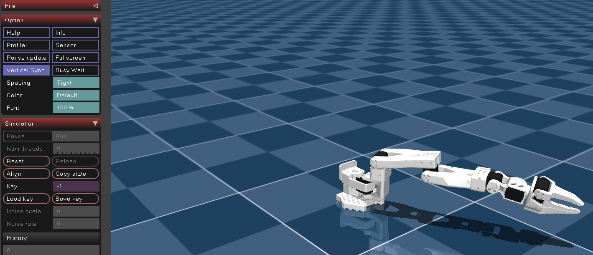
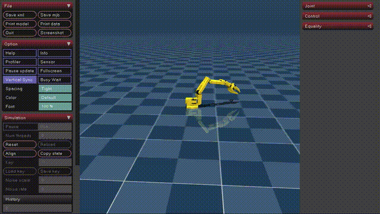
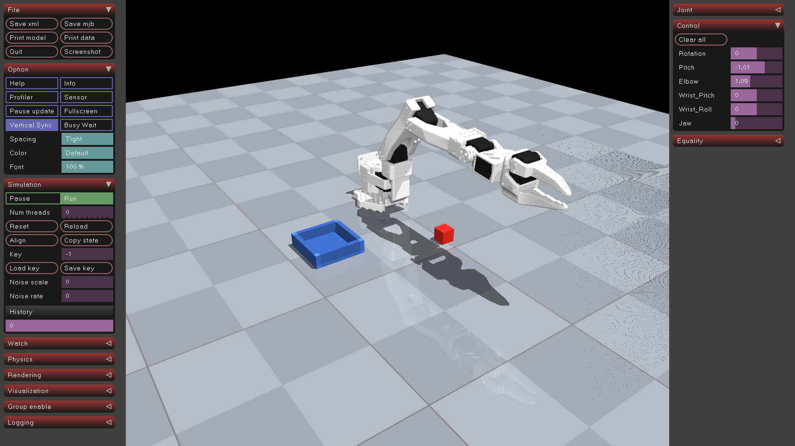

# robot-quant

Dissertation project investigating whether the throughput–accuracy trade-off observed in NPU-deployed frame classification also applies to **closed-loop robotic control**, and whether **INT8 quantization degrades continuous control more severely than it degrades classification**.



## Status

| Stage | State |
|---|---|
| MuJoCo simulation of the SO-ARM100 arm | Working |
| Scripted demo | Working |
| Policy inference (FP32 baseline) | Running in the MuJoCo viewer. Success rate not yet measured |
| INT8 quantization | TODO |
| NPU deployment and benchmarking | TODO |

## Repository layout

```
robot-quant/
├── assets/
│   └── so_arm100/          # MuJoCo arm model (vendored, see Attribution)
│       ├── pickplace.xml   # arm + cube + tray: the work-cell used in this project
│       ├── scene.xml       # arm + floor/lighting (not used yet)
│       ├── so_arm100.xml   # the arm model itself
│       ├── assets/         # STL meshes
│       ├── LICENSE
│       └── CHANGELOG.md
├── docs/
│   ├── HUGGING_FACE.md     # how the model's files map to the inference script
│   └── MODEL_SELECTION.md  # why this model/policy was chosen
├── images/                 # images used in the README and docs
├── papers/                 # reference papers (PDF)
├── script/
│   ├── test_mujoco.py      # scripted back-and-forth arm demo
│   └── run_policy.py       # runs the pretrained ACT policy in the work-cell
├── videos/                 # demo recordings
└── requirements.txt
```

## Setup

Run once from the repository root. Python 3.12 is required: LeRobot's config loading fails on Python 3.14.

```bash
# Option A: Python 3.12 already installed
python3.12 -m venv .venv

# Option B: let uv fetch Python 3.12 (leaves the system Python alone)
# curl -LsSf https://astral.sh/uv/install.sh | sh
# uv venv --python 3.12 .venv

source .venv/bin/activate          # Windows: .venv\Scripts\Activate.ps1
python --version                   # should print 3.12.x
python -m pip install --upgrade pip
pip install -r requirements.txt    # includes mujoco and lerobot
python -c "import mujoco; print('MuJoCo:', mujoco.__version__)"
```

Every later session only needs the `source .venv/bin/activate` line.

## Usage

### Run the pretrained policy

```bash
python script/run_policy.py
```

Options:

| Flag | Default | Meaning |
|---|---|---|
| `--episodes N` | 5 | Number of episodes to run |
| `--seed S` | 123 | Random seed for the block spawn positions |

The first run downloads the model (about 200 MB) from Hugging Face into its local cache. After that it loads from the cache.

Each episode:

1. The arm returns to its `home` pose and the block is placed at a random spot in front of the robot, 0.19 to 0.27 m from the base.
2. The policy receives the joint angles and two 224 x 224 camera images (`front` and `wrist`) and outputs 6 joint targets, at 15 Hz.
3. The episode runs for 16 s (240 steps) in the MuJoCo viewer, then resets.

The terminal prints the block position at the start of each episode, and `max |action - state|` at step 0. That value is a units check, and it should be small.

https://github.com/user-attachments/assets/e418ac85-5644-495e-875c-56443aa299c5

**Notes:**

- A GPU is not needed. On a CPU-only machine LeRobot prints "Device 'cuda' is not available. Switching to 'cpu'". The warning is harmless.
- There is no automatic success detection yet, so results are judged by watching the viewer.
- The spawn region (`R_RANGE`, `THETA_RANGE` in the script) is carried over from an earlier version and is not yet confirmed against the model's training data.
- If the renderer crashes with a segmentation fault, try `MUJOCO_GL=egl python script/run_policy.py`.

The model and its inputs are described in [`docs/HUGGING_FACE.md`](docs/HUGGING_FACE.md).

| | |
|---|---|
| Model | [`ahmedsohail2003/act-so101-pickplace-dr`](https://huggingface.co/ahmedsohail2003/act-so101-pickplace-dr), an ACT policy (51.6M parameters) |
| Training data | [`ahmedsohail2003/so101-sim-pickplace-dr`](https://huggingface.co/datasets/ahmedsohail2003/so101-sim-pickplace-dr): 150 MuJoCo episodes at 15 fps |
| Inputs | 6 joint angles (radians) + `front` and `wrist` cameras |
| Output | 6 absolute joint targets (radians) |

### Run the scripted demo

```bash
python script/test_mujoco.py
```

Opens the MuJoCo viewer and moves the arm back and forth. Close the viewer window to stop the script.



### Open the work-cell in the interactive viewer

```bash
python -m mujoco.viewer --mjcf=assets/so_arm100/pickplace.xml
```

Opens the SO-ARM100 work-cell: the arm, a cube and a tray.

On macOS, use `mjpython` in place of `python` if the viewer refuses to launch.

### Move the cube



1. **Pause the simulation** with `Space`. The cube only moves reliably while the simulation is paused.
2. **Select the cube:** hold `Ctrl` + `Shift` and double left-click it.
3. **Move it:** once the cube turns bright red, hold `Ctrl` + `Shift` and hold the right mouse button while dragging.
4. Press `Space` again to resume the simulation.

#### Viewer controls

| Action | Control |
|---|---|
| Pause / resume physics | `Space` |
| Rotate camera | Left-drag |
| Pan camera | Right-drag |
| Zoom | Scroll wheel |
| Select a body | Double-click |
| Move the arm joints | Right-hand **Control** panel sliders |

## Documentation

- [Model selection](docs/MODEL_SELECTION.md): scoring rubric and candidate comparison. Current provisional pick: [`ahmedsohail2003/act-so101-pickplace-dr`](https://huggingface.co/ahmedsohail2003/act-so101-pickplace-dr) (ACT, simulation-first). NPU latency and INT8 accuracy drop are still to be measured.
- [Hugging Face model notes](docs/HUGGING_FACE.md): how to read a Hugging Face model repository, and where each value in `run_policy.py` comes from.

## References

Papers kept in [`papers/`](papers/):

- *A Reduction of Imitation Learning and Structured Prediction to No-Regret Online Learning* (DAgger)
- *Quantization and Training of Neural Networks for Efficient Integer-Arithmetic-Only Inference*
- *Quantization-Aware Imitation Learning for Resource-Efficient Robotic Control*

## Attribution

The arm model in `assets/so_arm100/` is vendored from [MuJoCo Menagerie](https://github.com/google-deepmind/mujoco_menagerie) (`trs_so_arm100`), licensed Apache-2.0; see [`assets/so_arm100/LICENSE`](assets/so_arm100/LICENSE).

The work-cell scene (`pickplace.xml`) and the `tcp` site and `wrist` camera added to `so_arm100.xml` come from [`ahmedsohail2003/workcell-partA-imitation`](https://github.com/ahmedsohail2003/workcell-partA-imitation). <!-- TODO: confirm that project's licence and add it here. -->

The pretrained policy is not stored in this repository. It is downloaded at runtime from [`ahmedsohail2003/act-so101-pickplace-dr`](https://huggingface.co/ahmedsohail2003/act-so101-pickplace-dr) (Apache-2.0).

## License

<!-- TODO: add your licence for the original code in this repo. -->
