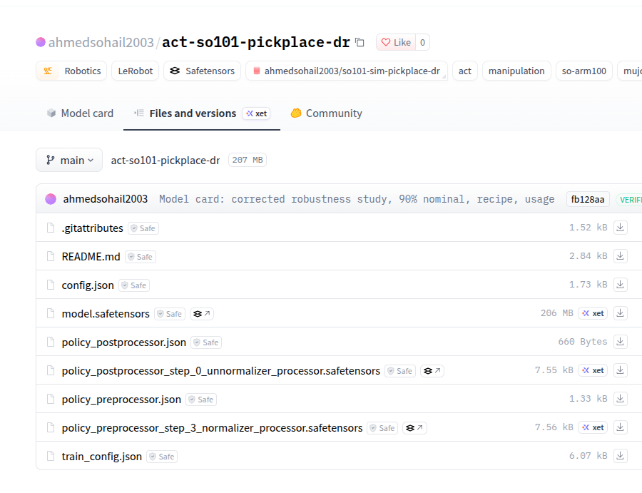

# Driving a Pretrained Hugging Face Policy from Project Code

Grabbing a model off Hugging Face and getting it to actually run on a robot—whether inside a simulator like MuJoCo or on a physical arm—is not as simple as downloading the weights. A neural network has no idea whether its inputs come from a physics engine or real servo motors; as long as your code feeds it tensors with the right shapes, units, and frame rate, it will output valid actions.

This section covers two things: how to inspect a Hugging Face repository so you avoid common integration bugs, and how we mapped the exact numbers from `ahmedsohail2003/act-so101-pickplace-dr` into our control script (`script/run_policy.py`).

---

## Part 1: What is actually inside a Hugging Face model?

### 1.1 Weights aren't enough
When you look at a model repo, it is tempting to just grab the biggest file and call it a day. That does not work. The weights file is just a massive wall of numbers—it does not tell you what shape the inputs need to be, how to scale them, or what the outputs mean. 

The rest of the files in the repository answer those questions, so read them first and write code second. Most of the common integration bugs in robotics—wrong units, misaligned camera views, mismatched frame rates—come from skipping this step.

### 1.2 The files that matter
Our model uses **LeRobot**, so the layout looks like this. Other libraries name things differently, but you are always looking for the same answers:

* **`README.md` (Model Card):** What the model does, how well it performed, the license, and usually a copy-paste snippet to load it.
* **`config.json`:** The contract. Tells you exact input/output names, tensor shapes, and chunk sizes.
* **`train_config.json`:** How it was trained (dataset name, steps, batch size, random seed).
* **`model.safetensors`:** The actual learned weights. You never open this manually.
* **`policy_preprocessor.json` (+ normalizer `.safetensors`):** How raw inputs get scaled and prepped before hitting the network, plus the training stats used to do it.
* **`policy_postprocessor.json` (+ unnormalizer `.safetensors`):** How raw network outputs get converted back into real robot actions.

One further file lives outside the model repository: the training dataset's `meta/info.json`, which holds the frame rate, the camera names, the joint order and the dataset size. For this model's dataset, the relevant parts are shown below. The file is trimmed, and omitted fields are marked `// ...`.

```jsonc
{
    // ...
    "fps": 15,
    "features": {
        "observation.state": {
            // ...
            "shape": [6],
            "names": ["Rotation", "Pitch", "Elbow", "Wrist_Pitch", "Wrist_Roll", "Jaw"]
        },
        // ...
        "observation.images.front": { /* ... */ },
        "observation.images.wrist": { /* ... */ },
        // ...
    },
    "total_episodes": 150,
    "total_frames": 16713,
    "total_tasks": 1,
    "chunks_size": 1000
    // ...
}
```

The camera names are the two `observation.images.*` keys, and the six joint names give the order of the 6-value state. The action uses the same six names in the same order.

### 1.3 How to read a repo (in order)
1. **Check the model card.** Grab the "Use" snippet—it is the author's working loader, so start there.
2. **Check the tags.** Tags like `LeRobot` and `act` tell you which library and Python class to import.
3. **Read `config.json`.** Match your code's inputs and outputs to these exact names and shapes.
4. **Look up the training dataset.** Grab the name from `train_config.json` to fill in whatever details the model repo left out.
5. **Let the processors do the math.** Use `make_pre_post_processors` instead of normalizing tensors by hand—it is too easy to introduce a subtle math bug.

### 1.4 Getting the frame rate from the dataset
Frame rate belongs to the data, not the model. Usually, you just look at `meta/info.json` on the dataset page. 

---

## Part 2: Mapping `ahmedsohail2003/act-so101-pickplace-dr` to our code

Everything below comes straight from the files inside [`ahmedsohail2003/act-so101-pickplace-dr`](https://huggingface.co/ahmedsohail2003/act-so101-pickplace-dr) and its linked training dataset [`ahmedsohail2003/so101-sim-pickplace-dr`](https://huggingface.co/datasets/ahmedsohail2003/so101-sim-pickplace-dr). While our project uses MuJoCo as the simulation backend, the exact same interface contracts apply if deploying to a physical arm.

> 
> *Figure 1: The model repository layout on Hugging Face, mapping directly to the configuration and processor files analyzed below.*

### 2.1 Model overview & I/O contract
The model is an **ACT (Action Chunking with Transformers)** policy loaded via `ACTPolicy` in `lerobot` (`51.6M` parameters, `206 MB` in F32, Apache-2.0 license). 

From `config.json`, our control loop has to match this exact interface:
* **Inputs:** `observation.state` (6 values), `observation.images.front` (`3 x 224 x 224`), and `observation.images.wrist` (`3 x 224 x 224`), with no frame stacking (`n_obs_steps = 1`).
* **Output & Chunking:** `action` (6 values). The model predicts 45 steps ahead (`chunk_size`), executes 15 (`n_action_steps`), and then re-plans. Temporal ensembling is off (`null`).

### 2.2 Preprocessing, normalization, and runtime execution
While `config.json` outlines the tensor shapes, `policy_preprocessor.json` and `policy_postprocessor.json` explicitly define how data is scaled. The preprocessor pipeline maps `STATE`, `VISUAL`, and `ACTION` features to `"MEAN_STD"` normalization, pointing to `policy_preprocessor_step_3_normalizer_processor.safetensors` for the training statistics. 

The preprocessor runs four steps: renaming inputs (an empty map, so no change), adding a batch dimension, moving tensors to the device, and normalizing. Normalization is `(value - mean) / std`, and both numbers are fixed: they are computed once over the entire training set (all 16,713 frames across the 150 episodes) and stored in the normalizer file, so they do not change at runtime. Each joint angle has its own pair, and so does each colour channel of the images. The image statistics are the standard ImageNet values, so images must be supplied as float32 between 0 and 1. The postprocessor applies the reverse to the action, using the action statistics, and moves it to the CPU.

### 2.3 Wiring it into `script/run_policy.py`
Combining `config.json`, the processor configuration, and dataset timing gives us every constant in our script:

| Setting | Value | Source / Reason |
| :--- | :--- | :--- |
| `REPO` / `XML` | `ahmedsohail2003/act-so101-pickplace-dr` / `pickplace.xml` | Model page / project scene |
| `HZ` / `MAX_STEPS` | `15` / `240` | Dataset timestamps / safety cap above 174-frame max |
| `IMG` & format | `224`, `float32` in `[0, 1]`, `(C, H, W)` | `config.json` & ImageNet normalizer expectations |
| Cameras | `front`, `wrist` | `config.json` input keys (no augmentation used in training) |
| State & Action | `data.qpos[:6]` → 6 clipped targets in `data.ctrl` | Radians; absolute joint targets |
| Episode reset | `policy.reset()` per episode | Clears the internal 15-step action buffer |

*(Note: `config.json` defaults to `"cuda"`, so LeRobot prints a harmless fallback warning when running on CPU.)*
